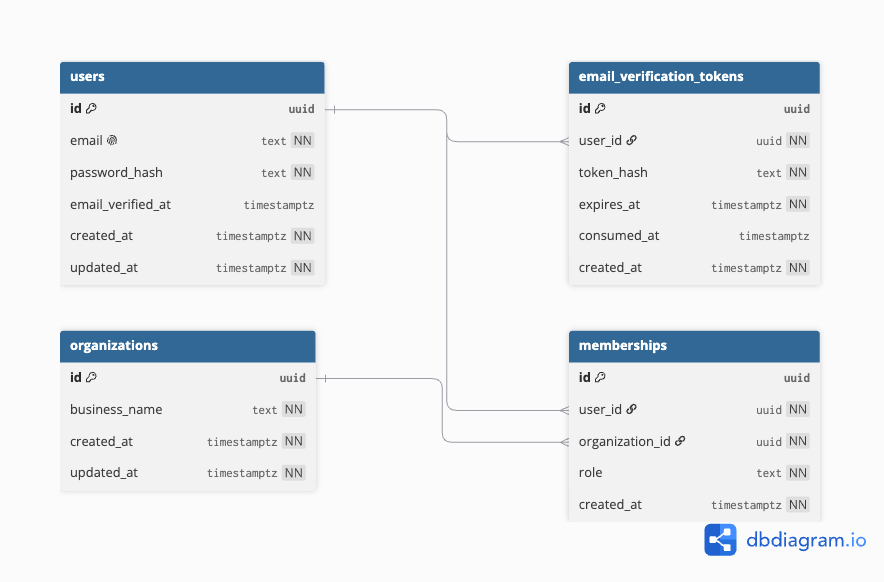

# Technical Design — Sign-up & Accounts (Project 1)

Status: Draft
Owner: Matt Millard
Last updated: 2026-08-08
Related: `docs/projects/01-signup/prd.md`

## Scope

Native email + password accounts, session auth, an authenticated dashboard empty
state, and retirement of the waitlist. No POS code. Data model is relational and
multi-user ready; UI ships single-owner.

## Flow

Verification is async: the account is usable and the session is live before the email
is ever opened. The verify branch can happen at any later time.

## Data model (Drizzle, `app/db/schema.ts`)

All ids are `uuid` (via `uuid().defaultRandom()`), matching the existing schema.
Rationale for UUID over serial int: no count leakage, no enumeration of accounts
(reinforces the enumeration-safety goal), safe in URLs, and generatable without a DB
round-trip (needed for the atomic multi-table insert at sign-up).

Restaurants and POS connections are NOT modeled in Project 1. Restaurants arrive in
Project 2, POS connections (and any POS-mirrored fields) in Project 3.

### `users`

- `id` uuid pk default random
- `email` text not null unique (store normalized lowercase)
- `password_hash` text not null
- `email_verified_at` timestamptz nullable (null = unverified)
- `created_at` timestamptz not null default now
- `updated_at` timestamptz not null default now

### `organizations`

- `id` uuid pk default random
- `business_name` text not null (authored by us at sign-up; this is the business
  name, distinct from any per-restaurant name, which Project 3 mirrors from a POS)
- `created_at`, `updated_at` timestamptz not null default now

### `memberships`

- `id` uuid pk default random
- `user_id` uuid not null fk -> users.id
- `organization_id` uuid not null fk -> organizations.id
- `role` text not null (`owner` | `manager` | `staff`; v1 only ever writes `owner`)
- `created_at` timestamptz not null default now
- unique (`user_id`, `organization_id`)

Rationale: user<->organization is many-to-many by design so a GM can be added later
with no destructive migration. v1 writes exactly one `owner` row per sign-up.

### `email_verification_tokens`

- `id` uuid pk default random
- `user_id` uuid not null fk -> users.id
- `token_hash` text not null (store hashed, never the raw token)
- `expires_at` timestamptz not null
- `consumed_at` timestamptz nullable (single-use)
- `created_at` timestamptz not null default now

A table rather than a column so tokens can be reissued/expired independently and it
composes with the future DB-backed `sessions` table (also a later "log out
everywhere" project).

Migration: new drizzle-kit migration adding these tables. `waitlist_signups` is
dropped outright (no data migration or export) in a separate, later migration, not
in the same migration that adds accounts.

### ERD

`memberships` is the join table making user<->organization many-to-many. v1 writes
exactly one `owner` membership per sign-up; the shape supports adding staff later
with no destructive migration.

## Auth

### Password hashing

- Use **bcrypt** via the `bcryptjs` package (pure-JS, no native build, so it
  builds cleanly on the Alpine Docker image). New dependency.
- Never log the password or hash. Hashing lives in a service under `app/domain/`
  or `app/services/`, not in the route.

### Sessions (RR7 cookie sessions)

- `createCookieSessionStorage` from React Router, server-signed with
  `SESSION_SECRET` (new env var, add to `.env.example`).
- Cookie: httpOnly, secure in production, sameSite=lax, sensible maxAge for
  "survives browser restart".
- Helpers: `getUserId(request)`, `requireUserId(request)` (redirect to login),
  `createUserSession(userId)`, `logout(request)`. Location: `app/auth/` or
  `app/services/session.ts` (decide during build, keep it out of routes).
- Design the helpers around a session identifier, not raw claims, so a future
  DB-backed `sessions` table (for "log out of all devices") can be added without
  changing call sites. That table is a deliberate later project, not Project 1.

### Enumeration safety

- Login failure returns one generic "invalid email or password" regardless of
  whether the email exists.
- Sign-up with an existing email: return a neutral message; do not confirm the
  address is registered beyond what is unavoidable.

## Forms & validation

- Use **Conform** (`@conform-to/react` + `@conform-to/zod`) for the sign-up and
  login forms: progressive enhancement, accessible field errors, and shared
  client/server Zod validation. New dependency.
- Zod schemas live in `app/domain/` as today:
  - `signupSchema`: email (reuse the existing email schema) + password (min length,
    e.g. >= 8, sane max, no upper-bound trap).
  - `loginSchema`: email + non-empty password.
- Note: Conform's `parseWithZod` returns a submission object, not the hand-rolled
  `{ ok, value | error }` shape in `app/domain/waitlist.ts`. New auth forms adopt the
  Conform shape; the waitlist code is being removed anyway, so the two don't need to
  be reconciled.
- Honeypot: implement via a Conform field that must stay empty (server rejects if
  filled). Keep it visually hidden and out of the tab order.

## Routes (`app/routes/`)

Loaders/actions thin; logic in domain/services.

- `signup` — GET renders form; POST validates, creates user + organization +
  owner membership in one transaction, starts session, redirects to dashboard.
- `login` — GET renders form; POST validates, verifies hash, starts session.
- `logout` — POST clears session, redirects to landing.
- `dashboard` — loader calls `requireUserId`; for Project 1 this renders only a
  placeholder heading ("Dashboard"). No real dashboard UI, empty state, or banner is
  built here; those come with later projects.
- `verify` — consumes a verification token, sets `email_verified_at`, redirects.
- Remove the waitlist route and its landing-page entry point.

### Transaction

User + organization + owner membership must be created atomically (Drizzle
transaction). Partial creation (user with no org, or no membership) is a broken
account.

## Components

Reuse existing hand-rolled primitives (FieldLabel, FieldError, SubmitButton seen in
recent commits). New screens follow `docs/STYLE_GUIDE.md`: quiet tier, leaf-cut
radius, type voices, no em dashes. Reserve space for conditional errors rather than
adding/removing nodes (known layout-shift preference).

## Testing

- **Domain (Vitest):** signup/login schema validation, including password rules and
  email normalization.
- **DB integration (PGlite):** sign-up creates exactly one user, one organization,
  one owner membership, atomically; duplicate email rejected; real Drizzle schema,
  no mocks.
- **Session:** helpers set/read/clear the cookie; `requireUserId` redirects when
  absent.
- **Enumeration:** login with unknown vs known email returns identical error shape.
- **E2E (Playwright, later):** sign-up -> dashboard, and login -> dashboard.
- No LLM calls anywhere in this project's tests.

## New dependencies / env

- `bcryptjs` for password hashing (ships its own types).
- `@conform-to/react` + `@conform-to/zod` for forms.
- `resend` for transactional email (verification). Add `RESEND_API_KEY` env var.
- `SESSION_SECRET` env var, documented in `.env.example` the moment it is introduced.

## Rollout / migration order

1. Add tables: `users`, `organizations`, `memberships`, `email_verification_tokens`
   (migration A).
2. Ship sign-up / login / logout / dashboard / verify.
3. Remove waitlist route + entry point.
4. Drop `waitlist_signups` (migration B).

## Decisions (from PRD)

- Password reset: separate follow-up project, not in scope here.
- `waitlist_signups`: dropped outright in migration B, no data migration.

### Email verification (async, non-blocking)

- `users.email_verified_at` timestamptz nullable (null = unverified).
- On sign-up: create account, start session, land in dashboard, then send the
  verification email via Resend out of band. Never block sign-up on it.
- Verification token: single-use, expiring, stored hashed in the
  `email_verification_tokens` table. The `verify` route consumes the token
  (`consumed_at`), sets `email_verified_at`, and redirects.
- The verification email is sent and the token/verify route work end to end. The
  "confirm your email" banner and resend UI on the dashboard are deferred with the
  rest of the dashboard UI (Project 1 dashboard is a placeholder heading only).
- Gating go-live / POS connect on a verified email is a later project, not here.

### Bot / abuse prevention

Verification does not stop bots (a bot simply never verifies). Controls that do:

In scope for Project 1:

- Rate limit sign-ups per IP and verification-resends per address per hour.
- Honeypot hidden field on the sign-up form.

Deferred:

- Unverified accounts stay inert (real value gated on verification in a later
  project) and can be reaped after N days.

## Open questions

None outstanding. Ready for ticket breakdown.
